# obs-live-deepgram-multi-transcribe

<p align="center"></p>
<p align="center">Créé par <a href="https://www.dragonship.eu"><strong>DragonShip Tools</strong> (www.dragonship.eu)</a></p>

Application de bureau légère pour afficher des sous-titres Deepgram en direct dans OBS. L'interface utilise la fenêtre native du système (WebView2 sur Windows, WebKit sur macOS) et reste un petit serveur local Python. OBS affiche une page locale séparée en tant que source navigateur.

> Fonctionnalités : capture d'une entrée audio, transcription en direct avec diarisation, traduction à la demande via LibreTranslate et overlay OBS. La transcription multilingue de Deepgram reconnaît plusieurs langues ; elle ne traduit pas le texte à elle seule.

## Fonctionnement

1. Dans le tableau de bord initial, configurez votre clé Deepgram, le port local et l'entrée audio du mix VoiceMeeter (Windows) ou BlackHole (macOS), selon votre routage. Un changement du port redémarre le serveur local et met à jour l'URL OBS affichée.
2. La même entrée peut contenir votre micro et l'audio du PC ; la diarisation distingue des changements de voix, mais ne garantit pas d'identifier chaque personne.
3. L'application capture l'entrée dans le navigateur intégré, convertit l'audio en PCM 16 kHz mono et l'envoie au serveur local.
4. Le serveur transmet les trames au WebSocket Deepgram via le SDK officiel Python `deepgram-sdk`. La clé API reste sur la machine et n'est jamais intégrée à l'overlay.
5. Quand le mode traduit est activé, les segments finalisés sont envoyés au service public LibreTranslate configuré dans l'application. L'audio reste envoyé à Deepgram ; aucun audio n'est transmis à LibreTranslate.
6. L'overlay local `http://127.0.0.1:<port>/overlay` reçoit les résultats et affiche les locuteurs. Dans OBS, ajoutez une **Source navigateur** avec l'URL exacte montrée dans le tableau de bord. Le bouton du dashboard synchronise le mode original/traduit entre l'aperçu et OBS.

L'audio est envoyé à Deepgram pour traitement. Consultez les conditions et la tarification Deepgram avant un stream prolongé. La clé API est enregistrée localement dans le fichier de configuration de votre profil utilisateur, séparé du dépôt : `%APPDATA%/obs-live-deepgram-multi-transcribe/config.json` sous Windows, `~/Library/Application Support/obs-live-deepgram-multi-transcribe/config.json` sous macOS, ou `$XDG_CONFIG_HOME/obs-live-deepgram-multi-transcribe/config.json` sous Linux. Le fichier n'est pas chiffré ; protégez votre compte utilisateur, utilisez une clé dédiée et révoquez-la si vous pensez qu'elle a été exposée.

### Traduction libre via LibreTranslate

La traduction est désactivée par défaut. Choisissez une langue cible dans **Configuration**, puis activez **Afficher la traduction** dans **Session & OBS**. Le bouton revient au texte original et arrête de mettre les nouveaux segments en file d'attente ; les segments déjà en file peuvent toutefois partir et finir leur traduction.

Le dashboard envoie uniquement le texte final des segments au service public `translate.cutie.dating` quand le mode traduit est actif. L'audio, la clé Deepgram et l'identité des locuteurs ne sont pas envoyés par la fonction de traduction. Le service public ne demande actuellement pas de clé à cette application et il n'y a aucun recours automatique à une API payante ; ses règles, quotas, délais et disponibilité peuvent toutefois changer. Comme pour tout service public en ligne, évitez cette fonction pour des conversations confidentielles et consultez la politique du fournisseur si la confidentialité est importante. La traduction peut ajouter du délai ou échouer si le service est indisponible ou limite les requêtes. En cas d’erreur, le tableau de bord et l’overlay signalent l’échec par segment et conservent le texte original.

## Coûts Deepgram

Le service n'est pas gratuit sans limite. La page tarifaire Deepgram annonce actuellement **200 USD de crédit de démarrage pour les nouveaux comptes**, puis une tarification à l'usage. Vérifiez dans la console que le crédit est bien disponible pour votre compte, suivez le solde et les paramètres de facturation, et consultez les [tarifs actuels](https://deepgram.com/pricing) : ils peuvent évoluer.

À titre indicatif, les tarifs publics consultés le 7 novembre 2026 donnent, pour Nova-3 avec diarisation :

- **Monolingue** : 0,0077 USD/min + 0,0020 USD/min de diarisation, soit environ **0,58 USD/heure**. 200 USD représentent environ **344 heures**. À deux heures par jour : environ 34,92 USD/mois et 5,7 mois de crédit ; à huit heures par jour : environ 43 jours.
- **Multilingue** : 0,0092 USD/min + 0,0020 USD/min de diarisation, soit environ **0,67 USD/heure**. 200 USD représentent environ **298 heures**. À deux heures par jour : environ 40,32 USD/mois et 5,0 mois de crédit ; à huit heures par jour : environ 37 jours.

Le tableau de bord affiche ces deux estimations et recalcule le coût mensuel et la durée indicative du crédit selon les heures de stream quotidiennes saisies. Ce calcul est une estimation, pas une promesse : la durée réelle dépend du modèle, des fonctions activées, du temps traité, des tarifs du moment et du crédit applicable à votre compte. Consultez la [console Deepgram](https://console.deepgram.com/) régulièrement.

### Compteur de crédit restant

Le tableau de bord peut lire les projets et leurs soldes USD via l'API de gestion Deepgram ([balances de projet](https://developers.deepgram.com/reference/manage/billing/list)). Deepgram expose un solde en dollars, pas un quota fixe d'heures ; l'application convertit ce solde en heures selon le tarif mono ou multilingue choisi. La lecture du solde requiert une clé API avec les droits de gestion appropriés. Choisissez le projet auquel la clé de transcription facture l'audio. Si la clé n'a pas ces droits, saisissez manuellement le crédit restant depuis la console.

Après la synchronisation ou la saisie, l'application suit le temps de stream effectué par **cette application** et en déduit une dépense estimée au tarif monolingue ou multilingue choisi ; elle affiche alors le crédit estimé et les heures restantes à ce tarif. Le compteur est conservé localement entre les lancements. Il ne connaît pas les autres requêtes du projet, donc actualisez le solde Deepgram pour les inclure. Le compteur reste une projection, pas un relevé de facturation.

Dans **Session de transcription**, vous pouvez aussi définir une **limite de coût estimé par session** en USD. Quand le coût estimé de la session atteint cette limite, l'application arrête automatiquement l'envoi audio et ferme la session Deepgram. Laissez le champ vide pour désactiver cette limite. Le réglage est conservé localement. C'est un garde-fou côté application, pas un plafond de facturation Deepgram : le coût réel peut différer et un léger dépassement est possible en raison de la granularité de mise à jour et du temps de fermeture du flux.

### Créer une clé API et choisir ses permissions

1. Ouvrez la [console Deepgram](https://console.deepgram.com/), sélectionnez le projet qui doit recevoir les frais, puis allez dans **Settings → API Keys → Create a New API Key**.
2. Pour utiliser la transcription en direct, choisissez **Default**. Ce rôle donne la permission `usage:write`, nécessaire pour appeler les services Deepgram ; les rôles plus élevés ne sont pas requis pour transcrire.
3. Donnez un nom reconnaissable à la clé, copiez-la une seule fois et collez-la dans l’onglet **Configuration**. Ne la publiez jamais dans GitHub, une capture d’écran ou un fichier partagé. Préférez une clé dédiée à l’application, que vous pourrez révoquer.
4. Pour **Actualiser le solde Deepgram**, l’application doit aussi lister les projets et lire leurs soldes. Dans le sélecteur de rôles affiché dans la console, choisissez **Admin** : la description Deepgram indique que ce rôle peut consulter le plan et le solde. Ce rôle est plus étendu que ce qu’exige la transcription seule. Si vous ne souhaitez pas accorder Admin, gardez **Default** et saisissez le crédit restant manuellement dans l’onglet **Quota & coûts**.
5. Vérifiez que le projet choisi dans le dashboard est celui associé à la clé de transcription. Le compteur ne mesure que l’utilisation effectuée par cette application depuis la dernière synchronisation ; il ne constitue pas un plafond de dépense.

Les rôles disponibles et leurs droits sont ceux présentés dans la console au moment de créer la clé ; vérifiez-les avant de confirmer. Consultez le guide Deepgram [Creating API Keys](https://developers.deepgram.com/docs/create-additional-api-keys) et sa page [Authenticating](https://developers.deepgram.com/guides/fundamentals/authenticating).

## Lancer en développement

Prérequis : Python 3.10+ et une clé API Deepgram.

```bash
python -m venv .venv
# Windows PowerShell
.venv\Scripts\Activate.ps1
# macOS
source .venv/bin/activate
python -m pip install -r requirements.txt
python run.py
```

La fenêtre de configuration s'ouvre. Entrez la clé, choisissez l'entrée audio et la langue, puis cliquez sur **Démarrer**. Autorisez l'accès au microphone si le système le demande.

Le tableau de bord est organisé en onglets **Configuration**, **Quota & coûts** et **Session & OBS** pour garder les commandes et l'aperçu faciles à trouver. La fenêtre peut être redimensionnée ou maximisée ; chaque onglet s'adapte à l'espace disponible.

## Installer le périphérique audio virtuel

- **Windows** : si vous souhaitez capturer un mix audio du PC, routez les sources vers VoiceMeeter ou un câble audio virtuel compatible, puis sélectionnez l'entrée correspondante dans le tableau de bord.
- **macOS** : installez BlackHole ou un périphérique équivalent, configurez un périphérique multi-sortie si vous devez entendre le son tout en le capturant, puis sélectionnez BlackHole.

Ces pilotes sont externes au projet et ne sont pas installés automatiquement.

## OBS

Dans l'onglet **Session & OBS**, choisissez les couleurs des noms de six locuteurs ; elles sont enregistrées localement et synchronisées avec l'overlay OBS. Chaque ligne disparaît après neuf secondes, de la plus ancienne à la plus récente. Utilisez **Copier l’URL OBS** pour coller l'adresse dans une **Source navigateur**. L’adresse complète n’est pas affichée dans le dashboard ; **Ouvrir l’overlay** permet de vérifier le rendu dans une fenêtre séparée. Port par défaut : `8765`. Taille conseillée : 1920 × 1080. L'overlay est transparent et se met à jour tant que l'application tourne.

Choisissez la langue cible dans **Configuration**, puis cliquez sur **Afficher la traduction** dans **Session & OBS** pour basculer en direct entre texte original et texte traduit. Le même mode s'applique au dashboard et à l'overlay OBS. La traduction commence lorsque le segment Deepgram est finalisé, donc elle peut apparaître un peu après l'original. La sélection d'une langue source précise donne une meilleure détection ; avec **Détection multilingue**, le texte de chaque segment utilise la langue détectée par Deepgram quand elle est disponible.

## Installation pour les utilisateurs

L'interface de l'application est intégrée dans une fenêtre de bureau et utilise un thème graphite cyberpunk à accents rouges ; le filigrane DragonShip fourni s'affiche en fond à 50 % d'opacité (avec sa transparence interne d'origine). Le bouton d'actualisation des entrées audio se trouve à côté du sélecteur de périphérique.

L'icône de l'application reprend l'emblème DragonShip, recadré sur le logo, en violet (#9B7BFF) avec fond transparent.

Téléchargez l'installateur depuis la section **Releases** du dépôt GitHub :

- **Windows** : `obs-live-deepgram-setup-<version>.exe`. L'installateur place l'application dans Program Files, crée les raccourcis sélectionnés et la lance. Python et les dépendances de l'application sont embarqués. Il vérifie si le runtime Microsoft Edge WebView2 est présent et ne l'installe que s'il manque. Dans ce cas, le bootstrapper Microsoft nécessite Internet pour télécharger le runtime. Le setup n'est pas encore signé, donc Microsoft Defender SmartScreen peut afficher un avertissement.
- **macOS** : `obs-live-deepgram-macos.dmg`. Ouvrez l'image disque et glissez l'application dans Applications. Python et ses dépendances sont embarqués ; WebKit est fourni par macOS. Les versions distribuées par ce dépôt ne sont pas signées/notarisées, donc Gatekeeper peut afficher un avertissement au premier lancement.

VoiceMeeter et BlackHole sont des pilotes audio séparés : ils ne sont pas installés automatiquement.

## Construire les installateurs

Les paquets doivent être construits sur leur système cible (Windows sur Windows, macOS sur macOS). Le workflow GitHub Actions produit le setup Windows et l'image disque macOS lors d'un lancement manuel, puis les attache à une **Release** lors d'un tag `v*`.

Pour construire manuellement, installez les dépendances et PyInstaller puis générez le bundle :

```bash
python -m pip install -r requirements.txt
pyinstaller --clean --noconfirm obs-live-deepgram.spec
```

Sur Windows, installez Inno Setup 6, téléchargez le [bootstrapper WebView2 officiel](https://go.microsoft.com/fwlink/p/?LinkId=2124703) sous `installer/WebView2Setup.exe`, puis compilez `installer/obs-live-deepgram.iss` avec Inno Setup Compiler. Sur macOS, créez l'image disque à partir de `dist/OBS Live Deepgram.app` avec `hdiutil`. La signature/notarisation Apple reste à configurer pour supprimer les avertissements Gatekeeper.

Pour une compilation manuelle macOS, exécutez `bash make_macos_icon.sh` avant PyInstaller afin de générer l'icône `.icns` depuis le PNG transparent. Le workflow GitHub Actions effectue cette étape automatiquement.

## Limites de cette version

- Une seule entrée audio mixée ; pour des sous-titres séparés par source, il faut router micro et audio de bureau vers des entrées différentes et ajouter plusieurs sessions.
- La diarisation attribue des indices (`Locuteur 1`, `Locuteur 2`), sans connaître les identités réelles. Sur un mix, les chevauchements et la musique peuvent réduire la précision.
- La traduction utilise une instance publique, qui peut avoir de la latence, des limites ou des interruptions. Elle est désactivée par défaut et ne doit pas être utilisée pour du contenu confidentiel.
- Pas de test sur un compte Deepgram ni de validation audio/OBS sur les deux systèmes depuis cet environnement.

## Dépannage

- **Aucun périphérique** : démarrez l'application après avoir installé/configuré VoiceMeeter ou BlackHole, puis actualisez la liste.
- **« Permission dismissed » / autorisation microphone** : actualisez les entrées audio et autorisez le microphone dans la demande Windows/WebView. Vérifiez également **Paramètres Windows → Confidentialité et sécurité → Microphone → Autoriser les applications de bureau à accéder au microphone**, puis relancez la demande. La liste des périphériques est maintenant chargée sans afficher de demande de permission au démarrage.
- **Erreur Deepgram `NET-0001` / aucun texte** : cette erreur indique qu'aucune trame audio n'a atteint Deepgram dans le délai imparti. Vérifiez l'autorisation de capture audio, choisissez une entrée active dans **Configuration**, puis vérifiez qu'elle reçoit bien du son. L'application reprend l'AudioContext au démarrage et envoie des KeepAlive pendant les silences, mais une première trame audio réelle doit quand même parvenir au service.
- **Aucun texte** : vérifiez la clé, le crédit/projet Deepgram, la langue choisie et le niveau du périphérique dans le système.
- **OBS ne montre rien** : vérifiez que l'application est lancée et que l'URL `/overlay` de la source utilise le port indiqué dans le tableau de bord.

## Licence

MIT — voir [LICENSE](LICENSE).
